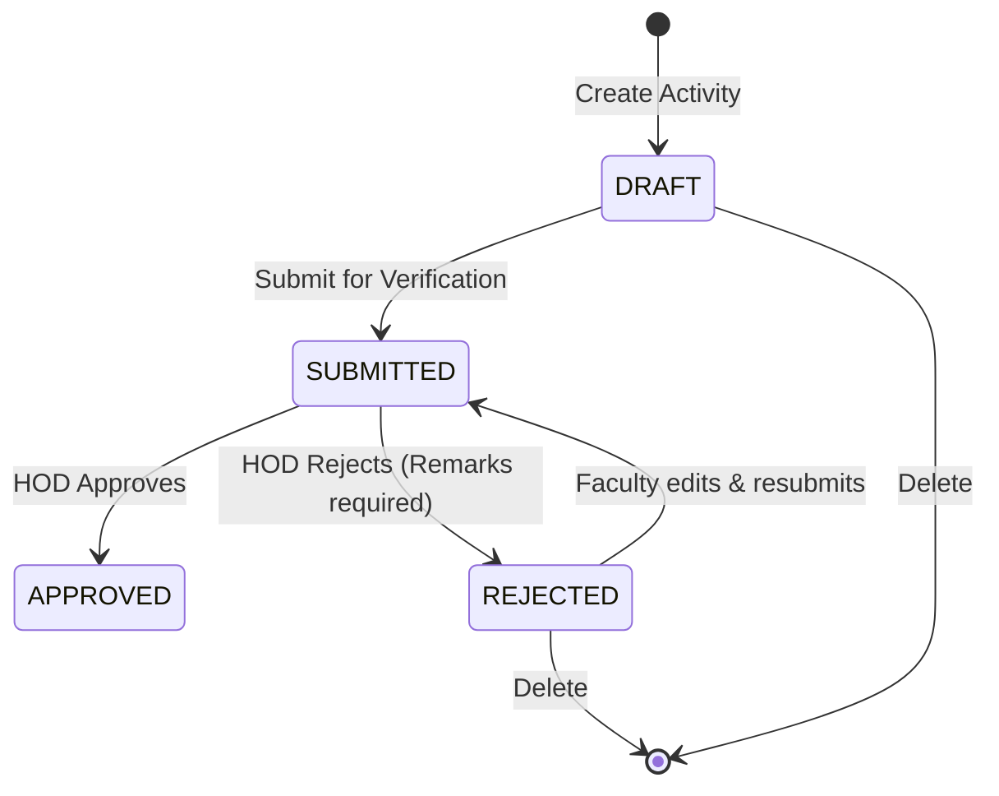

# Phase 5: Academic Activity Management

## 1. Overview & Objectives
Phase 5 implements the submission and tracking of academic contributions partitioned across the three standard institutional UGC categories.

---

## 2. Category Partitioning & Activity Life-Cycle

### 2.1 The Three Academic Categories
- **Category I — Teaching, Learning and Evaluation Activities**:
  Lectures, tutorials, practicals, preparation of course materials, innovative pedagogy, curriculum design, examination invigilation and evaluation, student mentoring.
- **Category II — Co-curricular, Extension and Professional Development**:
  Student discipline/cultural activities, community outreach, NSS/NCC leadership, organizing/attending FDPs, seminars, workshops, institutional administrative roles.
- **Category III — Research and Academic Contributions**:
  Refereed journal publications, books, book chapters, sponsored research projects, consultancy, patent grants, research scholar guidance, conference presentations, research awards.

### 2.2 Activity State Machine

- While in `DRAFT` or `REJECTED`, the faculty member can edit fields or delete the entry.
- Once `SUBMITTED` or `APPROVED`, direct modification or deletion is blocked to maintain audit integrity.

### 2.3 Instant Scoring Preview
- Upon creating an activity, the system looks up the corresponding active scoring rule (`APIScoringRule`) matching the category and `activity_type`.
- It evaluates and saves the `raw_score` immediately for user feedback, while `eligible_score` and `final_score` remain `0` until verified by the HOD.

---

## 3. Endpoints Implemented

| Method | Endpoint | Allowed Roles | Description |
| :---: | :--- | :---: | :--- |
| `GET` | `/api/activities/categories` | Any authenticated | List the 3 academic categories with descriptions and limits. |
| `GET` | `/api/activities/types` | Any authenticated | List configured activity types with base scores and scoring units (`?category_id=`). |
| `POST` | `/api/activities` | `faculty` | Create draft activity (requires active scoring rule). |
| `GET` | `/api/activities` | Any authenticated | Scoped list of activities (filtered by faculty, academic year, category, status). |
| `GET` | `/api/activities/<id>` | Any authenticated | Detailed activity view with linked documents and approval trail. |
| `PUT` | `/api/activities/<id>` | Owner / Admin | Update activity details (allowed only in `DRAFT` or `REJECTED` state). |
| `DELETE` | `/api/activities/<id>` | Owner / Admin | Delete activity (allowed only in `DRAFT` or `REJECTED` state). |
| `POST` | `/api/activities/<id>/submit` | `faculty` | Submit draft/rejected activity for HOD verification. |
| `GET` | `/api/activities/<id>/status` | Any authenticated | Check verification status, timestamps, and HOD remarks. |
