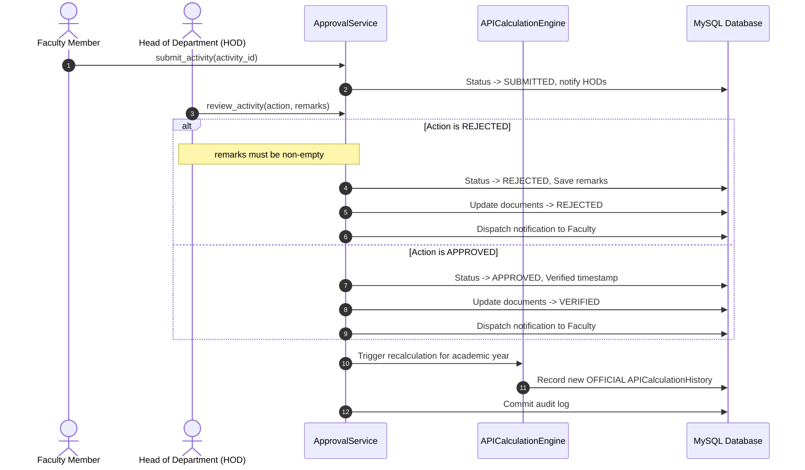

# Phase 7: HOD Verification Workflow

## 1. Overview & Objectives
Phase 7 implements the multi-step departmental review process, enabling Heads of Department (HOD) to inspect faculty profiles, verify or reject submitted activities with mandatory remarks, and track departmental performance metrics.

---

## 2. Verification Workflow & Business Logic

### 2.1 Department Isolation & Guard Rails
- **Department Bound**: An HOD user can only view, review, or verify activities submitted by faculty who belong to the same department (`user.department_id == activity.faculty.department_id`).
- **Self-Review Prevention**: An HOD who is also listed as an activity owner cannot verify their own activity.
- **Mandatory Rejection Remarks**: When setting `action = "REJECTED"`, the request must contain non-empty `remarks` explaining the reason for deficiency.
- **Document Status Synchronization**: Approving an activity automatically marks all associated `SupportingDocument` records as `VERIFIED`; rejection marks them `REJECTED`.
- **Automatic Recalculation**: Approving or rejecting an activity triggers immediate API recalculation for the affected faculty member, superseding prior official records.

---

## 3. Endpoints Implemented

| Method | Endpoint | Allowed Roles | Description |
| :---: | :--- | :---: | :--- |
| `GET` | `/api/hod/faculty` | `hod`, `admin` | List all faculty in the caller's department. |
| `GET` | `/api/hod/faculty/<id>/profile` | `hod`, `admin` | View complete profile, qualifications, and experience of department faculty. |
| `GET` | `/api/hod/activities/pending` | `hod`, `admin` | Submitted activities waiting for verification in department. |
| `GET` | `/api/hod/activities/submitted` | `hod`, `admin` | Filter department activities by verification status. |
| `POST` | `/api/hod/activities/<id>/verify` | `hod`, `admin` | Verify activity (`action`: `APPROVED` / `REJECTED`, `remarks`). |
| `POST` | `/api/hod/activities/<id>/approve` | `hod`, `admin` | Convenience shortcut to approve an activity. |
| `POST` | `/api/hod/activities/<id>/reject` | `hod`, `admin` | Convenience shortcut to reject an activity (requires `remarks`). |
| `POST` | `/api/hod/activities/<id>/remarks` | `hod`, `admin` | Add or update verification feedback remarks. |
| `GET` | `/api/hod/department-summary` | `hod`, `admin` | Department overview: faculty counts, submission statuses, official scores. |
| `PUT` | `/api/hod/documents/<id>/verify` | `hod`, `admin` | Standalone verification of supporting documents. |
