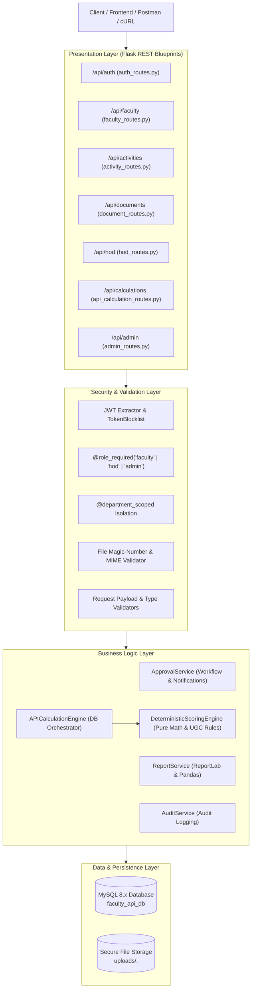

# Faculty Profile Builder - Phase-by-Phase Architecture & Execution Guide

This directory documents the complete architectural breakdown and phase-by-phase implementation of the **Faculty Profile Builder with Automated API Calculation System**, developed strictly using **Python, Flask, and MySQL** in accordance with the Master Development Specification.

---

## 1. Master Development Roadmap & Status Matrix

| Phase | Title | Primary Focus | Key Modules | Status |
| :---: | :--- | :--- | :--- | :---: |
| **01** | [Project Setup & Flask Configuration](01_phase1_project_setup.md) | App Factory, Extensions, Config, CORS, Environment | `app/__init__.py`, `app/config.py`, `app/extensions.py`, `run.py` | **COMPLETED** |
| **02** | [MySQL Database & Model Creation](02_phase2_mysql_models.md) | 17 Relational ORM Models, Foreign Keys, Constraints, Migrations | `app/models/*.py`, `migrations/`, `seed.py` | **COMPLETED** |
| **03** | [Authentication & Role-Based Authorization](03_phase3_authentication_rbac.md) | JWT Tokens, Server-Side Revocation, PBKDF2/Werkzeug, RBAC Guards | `app/routes/auth_routes.py`, `app/utils/decorators.py` | **COMPLETED** |
| **04** | [Faculty Profile Management](04_phase4_faculty_profile.md) | Profiles, Qualifications CRUD, Experience Breakdown Calculation | `app/routes/faculty_routes.py`, `app/models/faculty.py` | **COMPLETED** |
| **05** | [Academic Activity Management](05_phase5_academic_activity.md) | Category I, II & III Activities, Rule Lookups, Score Preview | `app/routes/activity_routes.py`, `app/models/activity.py` | **COMPLETED** |
| **06** | [Document Upload & Secure Storage](06_phase6_document_management.md) | Magic-Number/MIME Validation, UUID Paths, Traversal Protection | `app/routes/document_routes.py`, `app/utils/file_handler.py` | **COMPLETED** |
| **07** | [HOD Verification Workflow](07_phase7_hod_verification.md) | Department Isolation, Mandatory Rejection Remarks, Audit Trails | `app/routes/hod_routes.py`, `app/services/approval_service.py` | **COMPLETED** |
| **08** | [Automated API Calculation Engine](08_phase8_api_calculation_engine.md) | Pure Deterministic Engine, Caps, Proportional Allocation, Versions | `app/services/scoring_engine.py`, `app/services/api_calculation.py` | **COMPLETED** |
| **09** | [PDF Report Generation](09_phase9_pdf_reports.md) | ReportLab PDF Builder, Pandas Framing, Sign-off Headers | `app/services/report_service.py`, `app/routes/api_calculation_routes.py` | **COMPLETED** |
| **10** | [REST API Testing & Documentation](10_phase10_testing_documentation.md) | Pytest Suite (46 Tests Green), SQLite Isolation, API Docs | `tests/*`, `pytest.ini`, `README.md` | **COMPLETED** |
| **11** | [Integration, Localhost & Git Deployment](11_phase11_integration_deployment.md) | MySQL Setup, Seeding, Localhost Run, Git Remote Push | `run.py`, `seed.py`, `.env`, Git Remote | **COMPLETED** |

---

## 2. System Architecture & Component Interaction

---

## 3. Core Principles & Design Compliance

1. **Deterministic Calculation**: Official API calculations rely entirely on administrator-configured and versioned scoring rules (`APIScoringRule`). No artificial intelligence, LLM, or machine learning modifies or computes scores.
2. **Framework Exclusivity**: Implemented exclusively using **Python and Flask**. No Django, FastAPI, Node.js, Express, or PHP is used.
3. **Database Integrity**: Relational constraints, cascading deletes on dependent child entities, check constraints on status enumerations, and indexed foreign keys guarantee referential integrity in MySQL.
4. **Three-Tier Role-Based Security**:
   - `faculty`: Self profile management, qualifications, experience, activities entry, supporting document upload, score preview, and report retrieval.
   - `hod`: Department-scoped review, approval/rejection with mandatory remarks, document verification, departmental score summaries. Prohibited from verifying self activities.
   - `admin`: Full system management (users, departments, academic years, scoring categories, scoring rules, settings, audit trail, reports).
5. **Secure Evidence Storage**: Uploaded files undergo dual-layer validation (file extension + binary magic bytes header) and are stored under UUID filenames outside the web root with authorized download verification.
